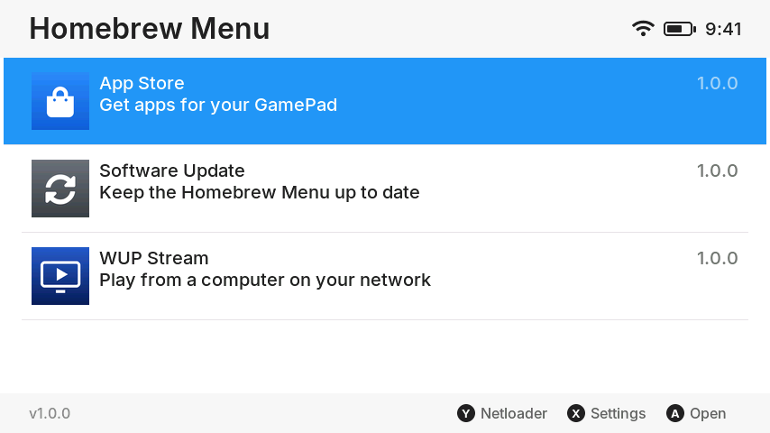
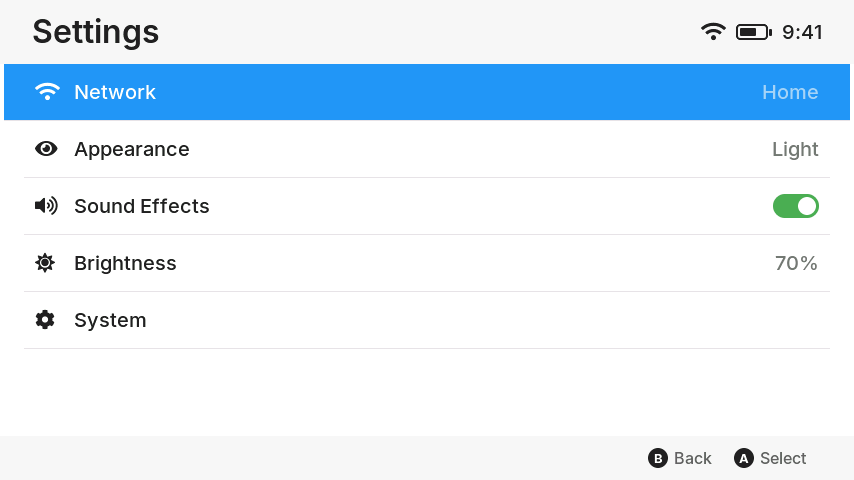

# wup-menu

The **Homebrew Menu** for the **Wii U GamePad** (model WUP-010): a small hook in the pad's own firmware, a loader,
and the menu. Everything was worked out from the pad's own firmware, and it runs on a real GamePad.

<p align="center"> </p>

- **Hold A at power-on** (or set Autoboot) for the Homebrew Menu. Without A the pad boots Nintendo's firmware
  exactly as before.
- The app list, Settings, Wi-Fi setup with an on-screen keyboard, battery, signal and a clock.
- **[WUP Boy](apps/wup_boy)** (in the App Store): Game Boy and Game Boy Color games you copy over File Sharing, with
  save states, rewind and fast forward. No games included.
- **App Store** and **Software Update** in the box: apps from the project's catalogue, newer Homebrew Menus, over HTTPS.
- **Wi-Fi** on normal WPA2 networks. **File sharing** over FTP for the pad's flash filesystem (8 MB).
  **Netloader**: send an app from a computer and run it.

Apps are built with [libwup](../libwup), the SDK; the menu itself is an app like the others.

## Install

- **From a Wii U** (no soldering): the [Homebrew Menu Installer](../wup-menu-installer), a
  Wii U app that installs through the GamePad's own firmware update.
- **Over UART** (soldering): `tools/flash/`, see [docs/install.md](docs/install.md).

After that, updates go over Wi-Fi. Read the safety notes in [docs/architecture.md](docs/architecture.md) first.

## Layout

| Folder | What |
|---|---|
| `boot/` | the hook patched into the firmware, and the loader |
| `menu/` | the Homebrew Menu |
| `tools/` | the install: `mkflash.py`, `menu_install.py`, `mkinstaller.py` (the Wii U installer's payload), `flash/` (UART) |
| `docs/` | [architecture](docs/architecture.md), [install](docs/install.md), [wiring](docs/wiring.md), [roadmap](docs/roadmap.md) |

## Build

Needs [libwup](../libwup) next to this folder (or `LIBWUP=path`) and what it needs (LLVM,
Python 3 with Pillow, meson, ninja).

```
python3 ../libwup/tools/wupbuild.py menu                        # -> build/apps/homebrew_menu.wup
python3 tools/mkflash.py DUMP.bin build/emu.bin                 # into a copy of your pad's flash dump: try it in wup-emu
WUP_PORT=tcp:PAD_IP python3 tools/menu_install.py menu          # update a pad's menu over Wi-Fi (Developer Mode on)
```

The emulator is [wup-emu](../wup-emu); dumps of your own pad stay outside every repository
(`../wup-firmware`, or `WUP_FIRMWARE=path`).

## Notes

- Only GamePad firmware LVC rev 7677 (`NR4_12_20140805_release`, Nintendo's last) is supported.
- No Nintendo code or firmware is included; the tools need dumps of your own pad.

## The catalogue

App Store and Software Update read one catalogue in the format of the Homebrew App Store's libget
(`repo.json`, `zips/<name>.zip`, `packages/<name>/icon.png`), at `CATALOG_URL` (`common/catalog.h`).
`python3 tools/mkrepo.py` builds it from the apps and the menu into `build/repo`; publish that folder over HTTPS
(GitHub Pages, for example). `tools/repo_server.py` serves it from this computer with a test CA, for test builds.

## Licence

GPL-3.0-or-later ([LICENSE](../LICENSE)), as the rest of [wup-homebrew](..).
