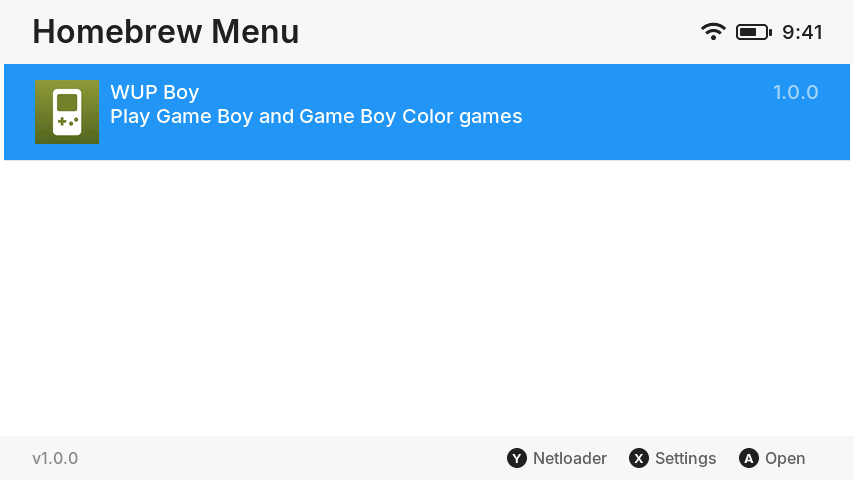
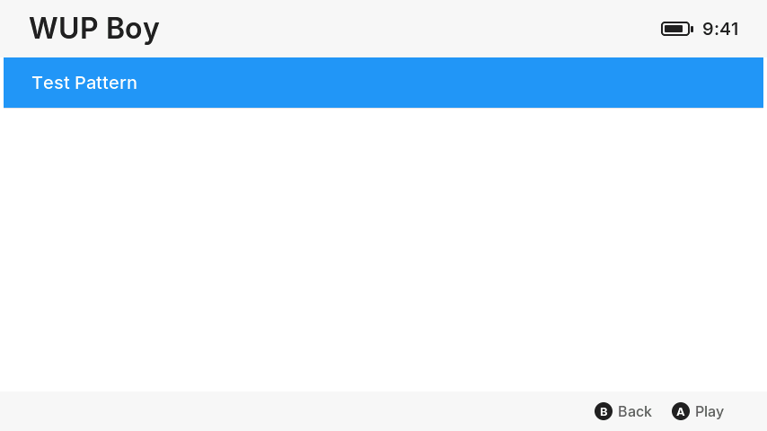
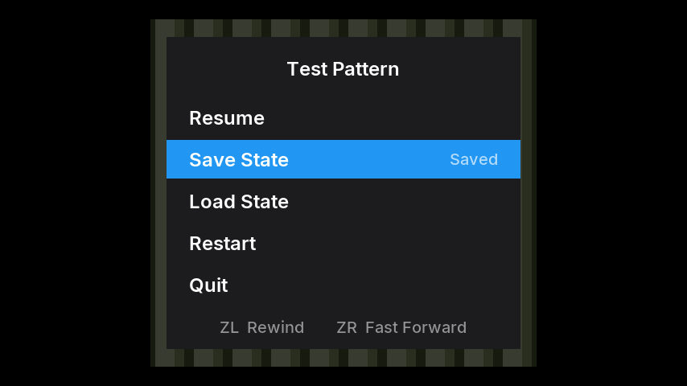

# WUP Boy

Game Boy and Game Boy Color games on the Wii U GamePad, for the [Homebrew Menu](../..). Get it in the GamePad's
**App Store**.

<p align="center"> </p>
<p align="center"> </p>

## Use

- **Your games**: turn on File Sharing in the menu's Settings and copy `.gb` and `.gbc` files to
  `apps/wup_boy/roms` (FTP). Games up to 1 MB fit. No games are included, only a test pattern made for this app
  (`testrom.py`); delete it like any other file.
- **Play**: A and B (X and Y too), **+** Start, **−** Select, the D-pad or the left stick.
- **HOME** pauses: Resume, Save State, Load State, Restart, Quit.
- Hold **ZL** to rewind, **ZR** to fast forward.
- The game's own save (its battery memory) is kept at every pause and when you quit, in `apps/wup_boy/saves`,
  with the save state next to it.

## How it is made

Two apps in one folder: the list of games (`main.c`, in the menu's look) and the player it starts with a game's path
(`player/main.c`), which draws on the GamePad's 8-bit layer so the whole game fits in memory. The emulation is
[Peanut-GB](https://github.com/deltabeard/Peanut-GB) (its `cgb` branch) with minigb_apu for sound, both MIT, fetched
by the build. Rewind keeps a ring of the differences between snapshots of the machine (XOR, run-length packed).

```
python3 ../../../libwup/tools/wupbuild.py .          # -> wup_boy.wup
python3 ../../../libwup/tools/wupbuild.py player     # -> wup_boy_player.wup (installed as player.wup)
```

Game Boy and Game Boy Color are trademarks of Nintendo; this is not affiliated with Nintendo. Use it with games you own.
